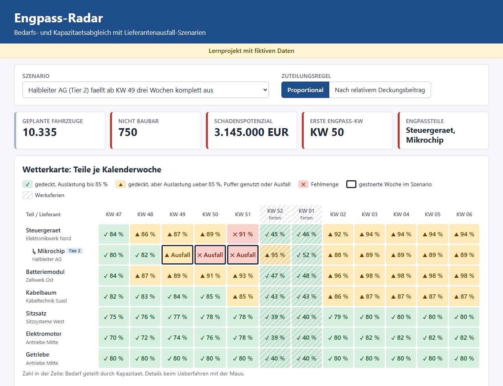
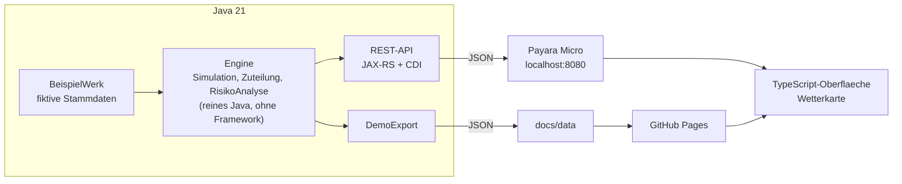

# Engpass-Radar

Ein kleines Planungswerkzeug, das ein Produktionsprogramm ueber die Stueckliste in Teilebedarfe aufloest, mit den Kapazitaeten der Lieferanten abgleicht und zeigt, was ein Lieferantenausfall kostet und welche Zuteilungsregel den Schaden senkt.

[](https://github.com/Uditp11/engpass-radar/actions/workflows/build.yml)


**Live-Demo:** https://uditp11.github.io/engpass-radar/

Lernprojekt mit fiktiven Daten, inspiriert von Bedarfs- und Kapazitaetsmanagement in der Automobillogistik.



## Was das Projekt zeigt

- **Stuecklistenaufloesung:** Geplante Fahrzeuge je Variante und Woche mal Menge pro Fahrzeug ergeben den Bruttobedarf je Teil.
- **Kapazitaetsabgleich:** Jeder Lieferant liefert hoechstens seine Wochenkapazitaet. Die Wetterkarte zeigt die Auslastung je Teil und Kalenderwoche.
- **Sicherheitsbestand:** Ein Puffer faengt kurze Ausfaelle ab und wird danach wieder aufgefuellt (Szenario Kabeltechnik: Ausfall ohne Schaden).
- **Mehrstufiges Netzwerk:** Das Steuergeraet (Tier 1) braucht vier Mikrochips eines Tier-2-Lieferanten. Ein Chipausfall kommt erst verzoegert im Werk an.
- **Szenarien:** Fuenf vordefinierte Stoerungen (Totalausfall oder Restkapazitaet in Prozent) plus eigene Szenarien ueber die API.
- **Massnahmen:** Zwei Zuteilungsregeln fuer knappe Teile, die Oberflaeche zeigt den Schaden beider Regeln nebeneinander.
- **Risiko-Ranking:** Jeder Lieferant faellt in jeder moeglichen Startwoche drei Wochen aus, der teuerste Zeitpunkt mal Ausfallwahrscheinlichkeit ergibt den erwarteten Schaden.

## Architektur



- Die Engine kennt kein Jakarta EE und ist dadurch direkt mit JUnit testbar.
- Die API und der Demo-Export nutzen dieselbe Engine und dieselbe JSON-B-Abbildung.
- Die Oberflaeche fragt zuerst die API (`api/...`). Ohne Server, zum Beispiel auf GitHub Pages, liest sie die exportierten Dateien aus `docs/data`.
- Kein Frontend-Framework, keine externen Bibliotheken zur Laufzeit. TypeScript im strikten Modus wird nach `docs/js/app.js` kompiliert.

## Modell und Regeln

**Woche fuer Woche:**
1. Bruttobedarf je Teil aus Programm und Stueckliste.
2. Der Lieferant liefert bis zu seiner Kapazitaet den Bedarf plus das Auffuellen des Puffers. Bei einem Teil mit Vorprodukt begrenzt zusaetzlich die Chipmenge (Kapazitaet, dann Chip-Puffer), wie viele Steuergeraete gefertigt werden.
3. Fehlt Liefermenge, wird der Sicherheitsbestand genutzt. Was danach fehlt, ist Fehlmenge.
4. Die verfuegbaren Teile werden mit einer Zuteilungsregel auf die Varianten verteilt. Nicht verbaute Teile bleiben im Bestand.
5. Schadenspotenzial = nicht gebaute Fahrzeuge x Deckungsbeitrag der Variante.

**Ampel je Teil und Woche:**

| Ampel | Bedingung |
|---|---|
| ROT | Fehlmenge > 0 |
| GELB | Bedarf gedeckt, aber Auslastung ueber 85 %, Sicherheitsbestand genutzt oder Kapazitaet 0 |
| GRUEN | sonst |

**Zuteilungsregeln:**
- *Proportional:* Jede Variante bekommt den Deckungsgrad ihres knappsten Teils (abgerundet).
- *Nach relativem Deckungsbeitrag:* Die Varianten werden nach Deckungsbeitrag pro Einheit des Engpassteils sortiert und gierig aufgefuellt.

**Erkenntnis:** Beim Steuergeraete-Engpass lohnt sich nicht das teuerste Fahrzeug, sondern der Benziner. Er braucht ein Steuergeraet und bringt 2.800 EUR je Steuergeraet, das SUV braucht drei (6.500 / 3 = 2.167 EUR), der Kompakt Elektro zwei (4.200 / 2 = 2.100 EUR). Im Szenario Halbleiter-Ausfall sind in KW 51 nur noch 350 Steuergeraete da:

| Regel | gebaut in KW 51 (Benzin / Elektro / SUV) | nicht baubar gesamt | Schadenspotenzial |
|---|---|---|---|
| Proportional | 81 / 61 / 48 | 750 | 3.145.000 EUR |
| Nach relativem Deckungsbeitrag | 350 / 0 / 0 | 590 | 2.960.000 EUR |

Die Massnahme spart 185.000 EUR.

## Bewusste Vereinfachungen

- Nicht gebaute Fahrzeuge werden nicht nachgeholt.
- Keine Liefer- und Transitzeiten: Was ein Lieferant in einer Woche fertigt, ist in derselben Woche im Werk.
- Jedes Teil hat hoechstens ein Vorprodukt, jedes Vorprodukt gehoert zu genau einem Teil.
- Die Zuteilung nach relativem Deckungsbeitrag ist eine Heuristik, keine Optimierung.
- Alle Daten sind fiktiv: drei Varianten, sieben Teile, sechs Lieferanten, zwoelf Wochen von KW 47 bis KW 06 mit Werksferien in KW 52 und KW 01.

## Tests

16 JUnit-5-Tests (`./mvnw test`):

- **SimulationTest (9):** Stuecklistenaufloesung, Basisplan ohne Engpass, hohe Auslastung wird gelb, Sicherheitsbestand faengt einen kurzen Ausfall ab, Tier-2-Ausfall schlaegt verzoegert auf das Steuergeraet durch, 100 % Restkapazitaet entspricht dem Basisplan, nie mehr verbaut als verfuegbar und nie mehr gebaut als geplant (fuer beide Regeln und alle Szenarien), Schadenspotenzial = Fehlmenge x Deckungsbeitrag.
- **ZuteilungTest (3):** Reihenfolge nach relativem Deckungsbeitrag, ohne Engpass wird alles gebaut, die Massnahme senkt den Schaden beim Chipausfall.
- **RisikoAnalyseTest (3):** Ranking vollstaendig und sortiert, erwarteter Schaden = Wahrscheinlichkeit x max. Schaden, ein Lieferant fuer zwei Teile hat den hoechsten Schaden.
- **JsonAbbildungTest (1):** JSON-B bildet das Ergebnis so ab, wie die Oberflaeche es erwartet (auch `auslastung = null` bei Totalausfall).

## Starten

Voraussetzung: JDK 21. Maven muss nicht installiert sein, der Maven Wrapper laedt es.

```bash
./run.sh        # Linux, macOS
run.cmd         # Windows
```

Danach laeuft die Anwendung auf http://localhost:8080/ (Payara Micro).

Weitere Befehle:

```bash
./mvnw test                     # Tests
./mvnw compile exec:java        # Demo-Daten in docs/data neu erzeugen
npm install && npm run build    # Oberflaeche nach docs/js kompilieren
```

## API

| Endpunkt | Beschreibung |
|---|---|
| `GET /api/stammdaten` | Werk, Varianten, Teile, Lieferanten, Stueckliste, Programm |
| `GET /api/szenarien` | vordefinierte Szenarien |
| `GET /api/analyse?szenario=halbleiter&regel=PROPORTIONAL` | Ergebnis eines Szenarios |
| `GET /api/analyse?lieferant=L2&start=3&dauer=2&rest=40` | eigenes Szenario: Lieferant, Startwoche (Index), Dauer, Restkapazitaet in % |
| `GET /api/risiko?dauer=3` | Risiko-Ranking |

```bash
curl http://localhost:8080/api/szenarien
curl "http://localhost:8080/api/analyse?szenario=halbleiter&regel=RELATIVER_DECKUNGSBEITRAG"
curl "http://localhost:8080/api/analyse?lieferant=L2&start=3&dauer=2&rest=40"
curl "http://localhost:8080/api/risiko?dauer=2"
```

Eine unbekannte Regel liefert `400 Bad Request`, ein unbekanntes Szenario oder ein unbekannter Lieferant `404 Not Found`.

## Naechste Schritte

- Liefer- und Transitzeiten zwischen Lieferant und Werk.
- Nachholen nicht gebauter Fahrzeuge im Folgeprogramm.
- Optimierung statt Heuristik bei der Zuteilung (zum Beispiel lineare Programmierung).
- Anbindung echter Planungsdaten statt des fiktiven Beispielwerks.
- Stoerungsmeldungen automatisch einem Lieferanten zuordnen, mit einem Menschen im Prozess, der die Zuordnung bestaetigt.

## English summary

Engpass-Radar is a small learning project with fictional data. It explodes a weekly production programme through a bill of materials into part demand, matches it against supplier capacity and safety stock across a two-tier supplier network, and simulates supplier outage scenarios. For each scenario it shows a heatmap of parts by calendar week, the vehicles that cannot be built, the lost contribution margin, and how an allocation rule based on contribution margin per bottleneck part reduces the damage. A risk ranking simulates every supplier failing at every possible start week. The engine is plain Java 21, exposed as a JAX-RS/CDI REST API on Payara Micro, with a framework-free TypeScript UI that also runs from static JSON on GitHub Pages.
